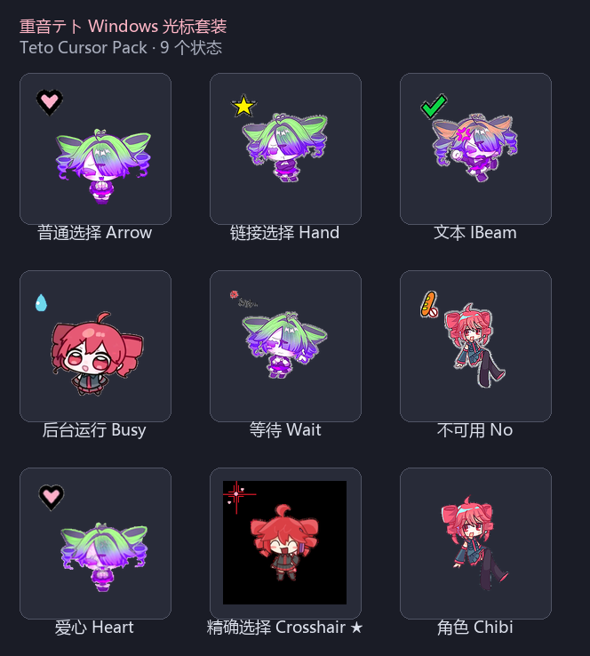
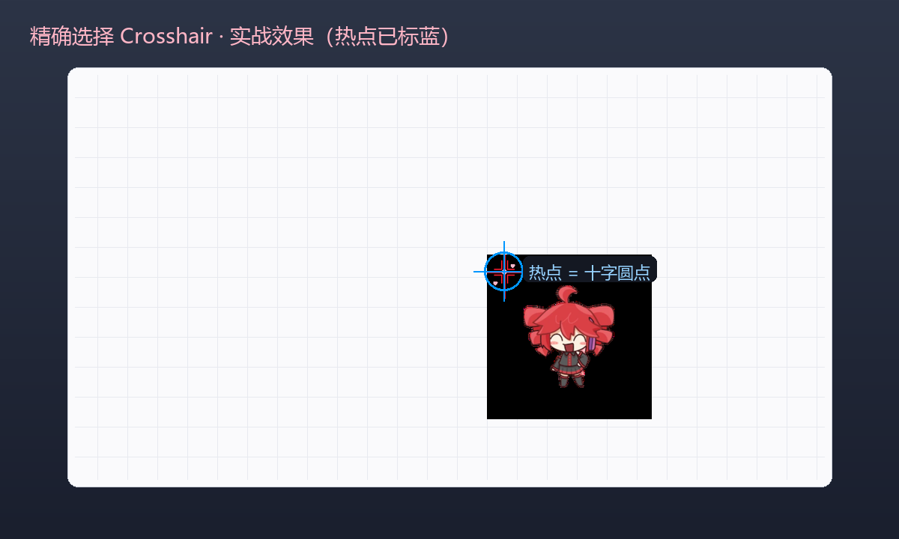
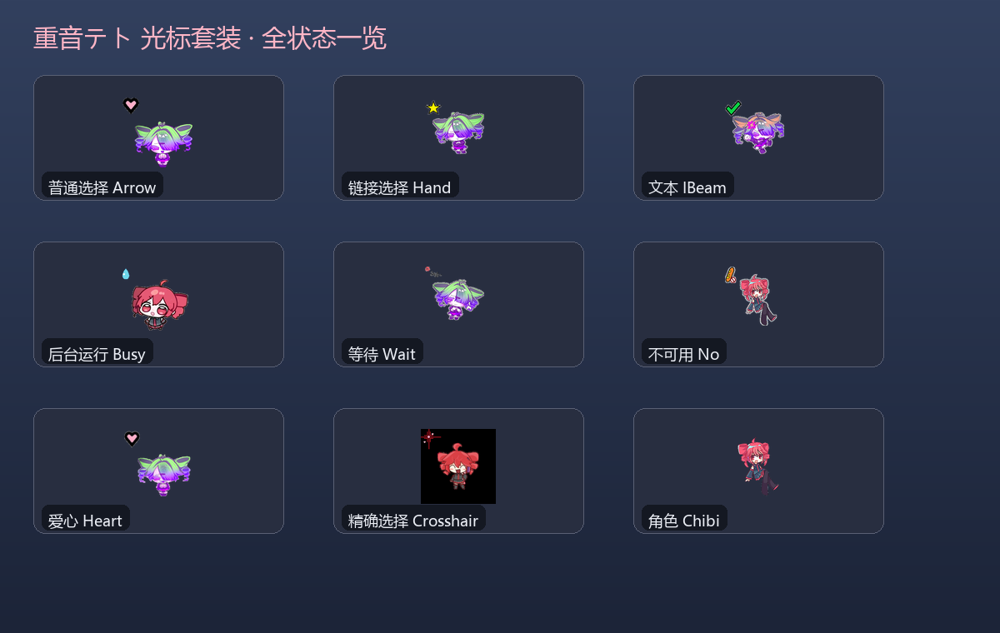

# 重音テト Windows 光标套装（Teto Cursor Pack）

一套用 **WorkBuddy（AI 工作搭档）** 从零生成的 Windows 自定义鼠标光标，主题是 VOCALOID 歌姬 **重音テト（Teto）**。
包含 9 个光标状态，其中「精确选择(Crosshair)」为本次新增：左上是红十字准星 + 两颗爱心，中间是 Teto chibi，热点落在十字圆点上。

> 本仓库为参加 **WorkBuddy 1024 造物挑战（应用创作大赛）** 整理的项目包。
> 报名入口：https://www.workbuddy.link/p/8QYARuAmZ9RgQty3FSzNUs （截止 2026-11-01 23:59）

---

## 光标状态一览

| 状态 | 文件 | 说明 |
| --- | --- | --- |
| 普通选择 | `teto_cursor.cur` | 主指针 |
| 链接选择 | `teto_hand.cur` | 手型 |
| 文本 | `teto_ibeam.cur` | 文本输入 |
| 后台运行 | `teto_busy_static.cur` | 后台忙 |
| 等待 | `teto_wait.cur` | 等待（动画） |
| 不可用 | `teto_unavailable.cur` | 禁止 |
| 爱心 | `teto_heart_static.cur` | 装饰款 |
| **精确选择** | `teto_crosshair.cur` | **新增**：十字 + 爱心 + Teto |
| 角色 | `teto_chibi.cur` | 纯角色指针 |

## 预览

### 光标全家福



### 鼠标使用效果图

**桌面使用场景** — 箭头 / 手型 / 文本光标在应用窗口里的真实效果：


**十字光标实战** — Crosshair 在画布上的形态，蓝色标出热点（十字圆点）：



**全套总览** — 9 个状态铺在桌面：



> 效果图由 `src/make_showcase.py` 生成（`python make_showcase.py`）。

---

## 技术亮点（为什么不是“换个图标”）

1. **手搓 `.cur` 二进制格式**：`.cur` 不能被 Pillow 写出，本项目手动拼装
   `ICONDIR` + `ICONDIRENTRY`×N + `BITMAPINFOHEADER` + XOR(BGRA) 掩膜 + AND(1bpp) 掩膜，
   每帧含 32/48/64/96/128/192/256 七档分辨率，大指针下不糊。
2. **梯度门控洪水填充抠图**：对贴纸风格的 Teto 源图做背景分割（梯度阈值 + 局部色彩容差），
   再按连通域保留最大块，并用 RGB 外扩(bleed) 防止降采样出现彩边。
3. **去光晕处理**：贴纸图自带白/粉辉光，脚本从掩膜边缘出发做 BFS，把与背景相连的近白像素“吃掉”，
   让边缘干净（实测毛边占比 < 0.3%）。
4. **平滑矢量爱心**：用参数方程 `x=16sin³t, y=13cos t−5cos2t−…` 生成矢量爱心，黑描边 + 粉填充，
   任意分辨率下都锐利。
5. **组合与热点**：左上为缩小的十字设计、中间为 Teto 主体，热点精确钉在十字圆点（约画布 9–11% 处）。
6. **自检脚本 `verify_cursor.py`**：直接解析 `.cur` 字节做像素级 QA——四角透明、毛边占比、
   各区域像素统计，保证每次生成都可验证。

---

## 如何构建（复现）

依赖：Python 3 + Pillow + numpy

```bash
cd src
python make_cursor_combo.py     # 生成 teto_crosshair.cur 到 ../cursors，并输出预览到 ../preview
python verify_cursor.py         # 逐字节校验 .cur
python render_gallery.py        # 生成全家福 preview/family_portrait.png
```

生成脚本使用**相对路径**，克隆后无需改配置即可运行。

---

## 如何安装到 Windows

方式一（推荐，仅改精确选择状态）：
1. 双击 `cursors/teto_crosshair.reg` 导入注册表。
2. 在「设置 → 蓝牙和设备 → 鼠标 → 其他鼠标设置 → 指针」里，选中“精确选择”后点“浏览”，
   指向 `teto_crosshair.cur` 即可。

方式二（整套替换）：在上面的“指针”面板里逐状态“浏览”并载入对应 `.cur`，最后“另存为”方案。

---

## 文件结构

```
teto-cursor-kit/
├── README.md
├── assets/
│   └── teto_chibi.png              # Teto 源图（用户提供）
├── cursors/                       # 9 个 .cur + Crosshair 的 .reg
├── preview/
│   ├── family_portrait.png        # 全家福
│   ├── crosshair_preview_*.png    # 十字光标效果预览
│   ├── cut_teto.png               # 抠图特写
│   └── crosshair_checker.png      # 棋盘格透明校验
└── src/
    ├── make_cursor_combo.py       # 主生成脚本（抠图+爱心+组合+编码+部署）
    ├── verify_cursor.py           # .cur 字节级自检
    └── render_gallery.py          # 全家福生成
```

---

## 说明

- 光标形象为粉丝向二次创作，仅个人使用与展示。
- 源图由用户提供，脚本不依赖任何外部素材库。
